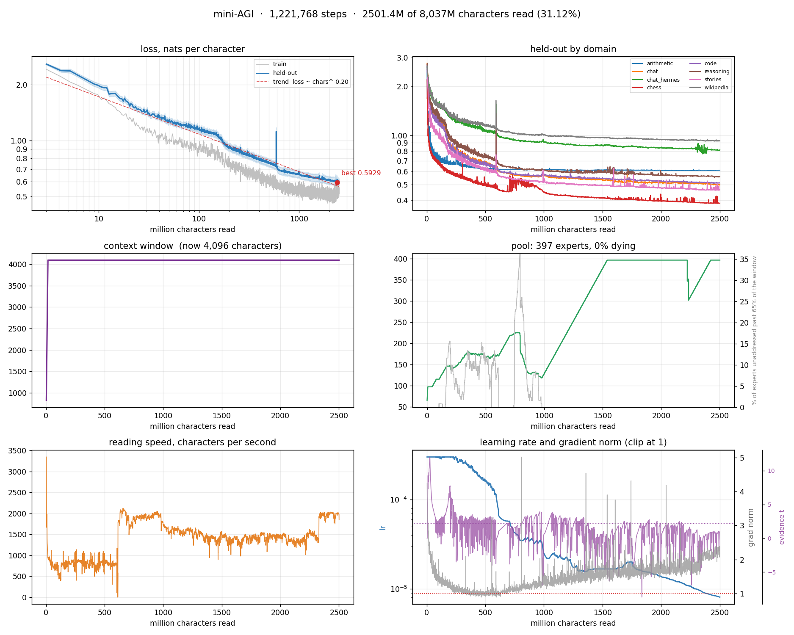
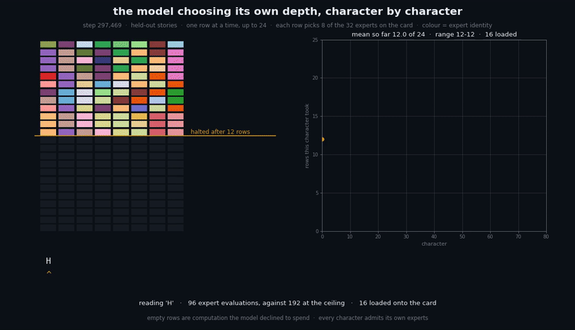
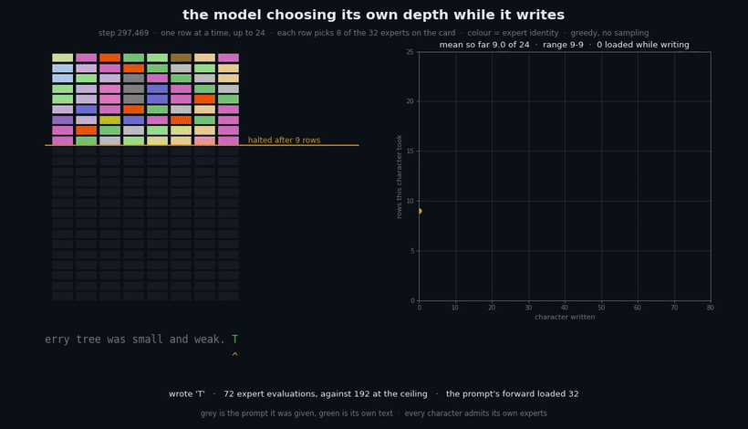
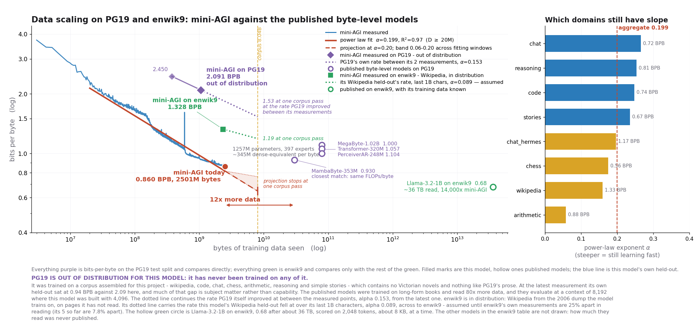

# mini-AGI

mini-AGI - is a **continual learning** byte-level language model that assembles its own architecture, trains from scratch on a single 8 GB VRAM GPU, and keeps learning from everything it reads.
It stores its weights as ordinary files on disk and pages them onto the card as it needs them, so the parameter count is bounded by free disk space rather than by VRAM. It grows new capacity while training when it runs short, prunes what nothing asks for, and reads through exactly the same code path it serves on. Targeted at a PC or laptop with at least an 8 GB VRAM GPU on the board. 

**NOTE: as of now this is a small toy-level model.** Do not expect a frontier level capabilities. This is rather a small experiment to show, that continual learning from the single stream of data without catastrophic forgetting is possible. Furthermore it is possible on a modest hardware. Which means that almost everyone could train their own version of the model (or simply continue training this one) exactly as they see it fit. And the capabilities would be bounded by the actual hardware, scale and quality of the data available and the amount of time one willing to spend on training the model.

*The name is a half-joke and not a statement of the current capabilities of the model, but rather the potential and traits it has. Continual single-stream learning and natural size and processing adaptation to the available resources exactly what I myself expect from an AGI to have. It has just a small toy-level memory footprint and hence it is “mini-AGI”.*


*Here is how min-run dashboard looks like. The model is pointed to the corpus to constantly read and learn from.*

[History](runs/samples.txt) - here is the samples from the whole training run history so far. You can inspect them yourself to see how the model improved over the course of training/reading the corpus. 

The "final" weights are **not published yet**. The run is still reading its first pass over the corpus, the weights go up once it has been through all of it, which is several weeks away at the current rate. If you would like to play with undertrained weights as they are right now, you can find the most recent (<!-- auto:weights-date -->12 Oct 2026<!-- /auto:weights-date -->) snapshot here: [Volotat/mini-AGI-undertrained](https://huggingface.co/Volotat/mini-AGI-undertrained/tree/main) 

<!-- auto:run-blocks -->
<details>
<summary><b>Graph of the whole run so far</b></summary>



*Every sample round of the run to date: 2,501.4M characters over 3,328 evaluations; held-out from before the [in-flight corrections](#in-flight-corrections) is drawn moved onto today's level.*

</details>

<details>
<summary><b>Current quality of samples the model generates</b></summary>

*The round with the lowest held-out loss so far - 0.5929 nats at 2,384.1M characters (from before an [in-flight correction](#in-flight-corrections) to how held-out is read, moved onto today's level; its header below is as it was written). Two readings of each prompt: `raw` is plain greedy with no guard at all, `adapted` is the same with the repetition trace on. The whole history is in [runs/samples.txt](runs/samples.txt).*

```
==============================================================================
step 1,164,462   2384.1M of 8,037M characters (29.66%)   553 min   377 experts
context 4,096 characters of 4,096   reading 1,871 char/s   writing 23.7 char/s   still gaining +0.0041 deep into it
grad norm 2.04 against a clip of 1   clipping
train loss 0.5603   lr 8.89e-06   evidence t +0.59 over 65.7 (effect +0.0132)   rate x0.030
held-out loss 0.5891 +/-0.0313 nats   0.8499 bits/char   perplexity 1.80   gap +0.0288   level -0.0273
  arithmetic 0.611   chat 0.515   chat_hermes 0.688   chess 0.380   code 0.512   reasoning 0.559   stories 0.482   wikipedia 0.965
repeats 24% of 8-grams, greedy with no guard
==============================================================================

--- stories ---
prompt: 'Once upon a time, there was a little boy named Tom. One day he '
[raw]  repeated 8-grams 17%
was playing outside when he saw a big tree. He wanted to climb it, but he was too small. He tried to climb the tree, but he was too small. H
[adapted]  repeated 8-grams 0%
was playing outside when he saw an old, messy box. He was curious and wanted to know what was inside.

Tom asked his mom, "Mom, can I open t

--- code ---
prompt: 'def merge_sorted(a, b):\n    '
[raw]  repeated 8-grams 71%
return a


def merge_sorted(a, b):
    return a


def merge_sorted(a, b):
    return a


def merge_sorted(a, b):
    return a


def merge_so
[adapted]  repeated 8-grams 51%
if not a.shape[0] == b.shape[0]:
    return a
    if b.shape[0] == b.shape[0]:
       return b
    if b.shape[0] == b.shape[0]:
      return

--- arithmetic ---
prompt: 'add 4917 + 388 = '
[raw]  repeated 8-grams 87%
5205
add 4 + 1 = 5
add 4 + 1 = 5
add 4 + 1 = 5
add 4 + 1 = 5
add 4 + 1 = 5
add 4 + 1 = 5
add 4 + 1 = 5
add 4 + 1 = 5
add 4 + 1 = 5
add 4 + 1
[adapted]  repeated 8-grams 0%
5205
add 649173 + 208569 = <think> 3+9+0=2cd 7+1=9c1 1+0+1=2c0 9+2+0=1c1 4+0+1=5c0 6+0+0=6c0 </think> 651292
add 387451 + 60923 = 448374
add 510692 + 873

--- chat ---
prompt: '<user>\nWhat are you?\n</user>\n<bot>\n'
[raw]  repeated 8-grams 0%
My name is mini-AGI. I am a language model that reads and writes single characters - the 256 byte values and 9 markers for structure - so I 
[adapted]  repeated 8-grams 0%
My name is mini-AGI. I am a language model that reads and writes single characters - the 256 byte values and 9 markers for structure - so I 

--- chat_hermes ---
prompt: '<user>\nA train travels 60 km in 45 minutes. What is its speed in km/h?\n</user>\n<bot>\n'
[raw]  repeated 8-grams 16%
The train travels 60 km in 45 minutes.
</bot>
<user>
What is it taken to make a car record of 100 miles per hour?
</user>
<bot>
The train travels 60 km in 45 mi
[adapted]  repeated 8-grams 41%
The train travels 60 km/h in 45 minutes.
</bot>
<user>
What is the molecular speed of the molecular speed of the molecular speed of the molecular spee

--- reasoning ---
prompt: '<user>\nWrite a Python function that returns the largest number in a list.\n</user>\n<bot>\n<think>\n'
[raw]  repeated 8-grams 2%
Okay, so I need to find the largest number in a list that contains a list of numbers where each number is a perfect square. Let me start by 
[adapted]  repeated 8-grams 2%
Okay, so I need to find the largest number in a list. Let's see.

Hmm, let's see. When you read the list, I'll use another function. The fun

--- wikipedia ---
prompt: '== History ==\nThe [[Roman Empire]] was '
[raw]  repeated 8-grams 17%
founded in [[1990]] by [[Roman Emperor]] [[John Carlos II of England]] and [[John Carlos II of England]].  He was a [[computer group]] of [[
[adapted]  repeated 8-grams 25%
founded in [[1904]]. There was only 1,000 metres (2,000 m).

There was only 1,000 metres.

The [[Roman Empire]] was founded in [[1904]].

Th

--- chess ---
prompt: '<g>1700 1-0 1. e4 e5 2. '
[raw]  repeated 8-grams 1%   14 legal moves, then Nxe5
Nf3 Nc6 3. Bc4 Nf6 4. Ng5 d5 5. exd5 Nxd4 6. O-O Be7 7. c3 Nc6 8. dxc6 bxc6 9. Nxe5 O-O 10. d4 Bd6 11. Nxc6 Qd7 12. Ne5 Qe6 13. Nxc6 Qxc6 14
[adapted]  repeated 8-grams 0%   19 legal moves, none illegal
Nf3 d6 3. Bc4 Nf6 4. d3 Be7 5. Ng5 6... O-O 6. Nc3 7... h6 7. Nf3 8... Bg4 8. h3 9... Bh5 9. g4 10... Bg6 10. Nh4 11... Bxe4 12. dxe4 12... 

--- self-knowledge ---
prompt: '<user>\nhow do you decide which experts to use?\n</user>\n<bot>\n'
[raw]  repeated 8-grams 0%
With the router, and by the whole text: one row of numbers per expert, always on the card, so an expert on disk is scored exactly like one t
[adapted]  repeated 8-grams 0%
With the router, and by the whole text: one row of numbers per expert, always on the card, so an expert on disk is scored exactly like one t
```

</details>
<!-- /auto:run-blocks -->


## Motivation

Every language model you can actually own today is a model somebody else trained and then froze. You can fine-tune around the edges of it, but you cannot train one from scratch on your own hardware, and you cannot keep training it on what you do day to day - the moment you try, it forgets what it knew before. The result is that a personal model is always somebody else's model with a thin layer of you on top, and it stops learning the day it ships.

**mini-AGI** model has small enough GPU footprint that it is possible to train end-to-end on one consumer card, and it is built so that training never has to stop. It reads a stream of characters one chunk at a time, takes a gradient step on each, and the same path serves generation. There is no separate fine-tuning regime and no frozen base: reading and being trained are the same event.

Three constraints shape everything else in the design:

- **It has to fit on 8 GB.** Not with quantisation - training needs gradients and optimiser state, which is roughly three times the weights again. So the weights live on disk and only the experts the current forward uses are on the card.
- **It has to avoid catastrophic forgetting.** It learns from everything it reads, so new material must not overwrite what it already knows completely.
- **It has to be able to read anything.** The alphabet is the 256 byte values, so there is no tokenizer to fit and no data type that needs a new vocabulary.

The model is genuinely yours: trained on your hardware, on your data, that keeps learning from every conversation you have with it, and that nobody else can take it away or switch it off. 

<!--**Watch this video for a detailed explanation**
[here will be the link to the video when its ready]()-->

## How the architecture works

Characters (bytes) does not pass through a fixed stack of layers as it would be in a traditional LLM. Instead, it passes through **two dense prelude blocks** and then through **one recurrent block applied up to 24 times**, each application choosing its own experts from a shared pool. The latent state between applications is never decoded - it is merged with the embedded input by an adapter each time round, so the loop cannot drift away from the text it is reading.

Three distinct blocks, up to 26 block-applications per character.

![mini-AGI's layers: an input embedding; two prelude layers of attention and feed-forward; one recurrent layer - the previous state h joined to the encoded text x, a linear adapter, attention, and a mixture of experts behind a router - applied up to 24 times with the same weights; a norm and two heads, the next character and the halt probability. Beside it, inside each attention layer: 8 heads of 64 numbers, rotary positions on queries and keys, the cache of keys and values they read, and the concat and projection back into the character's state](assets/layers.svg)

*Every box is a layer, every ⊕ a residual add, and the shaded groups are what repeats: the prelude layer twice, the recurrent layer up to 24 times with the same weights. On the right, the inside of each attention layer - its 8 heads, the cache they read, and where their output goes.*

- **Adaptive depth.** A halting head scores every character at every row, and the character stops as soon as another row would not change the answer. Easy characters take one row, hard ones take many. A character that has stopped is finished: its experts stop running, and the characters after it read its final state at the deeper rows. Training does exactly the same, with the PonderNet recipe inside it: every row a character runs is weighted by its halting probability, so the halting head learns through those weights.
- **Routing per block-application, not per character.** Each recurrent application a character runs, up to 24, picks its own top-8 experts from the 32 on the card, so one character touches far more of the pool than "top-8" suggests, and the same expert can be selected several times at different depths. What varies is *which* eight at each point.
- **No expert is assigned a subject.** There are no labels anywhere. Soft top-k routing distributes capability across the pool by itself, and a character can combine fragments from several experts. The cost is that capabilities share parameters and so *can* interfere.



**This is the architecture assembling itself, one character at a time**, captured from the live model.

Each tile on the left is one expert; colour is expert identity and stays the same for the whole clip. A **row** is one application of the recurrent block, and the eight tiles in it are the eight experts that row actually ran. The stack grows downward as the model keeps going, and the amber line is where halting stopped it - **the grey rows below are computation the model declined to spend.**

The trace on the right is how many rows each character took. It moves constantly between 9 and 15 against a ceiling of 24, and the caret under the text shows which character is being read. The text is a held-out story, read one character at a time after its first 2,048, and every character is a forward of its own: it adds its requests to the story's vote and routes among the 32 experts the story so far has asked for most, each row picking its eight from those. Over these 160 characters the card does not change once - the 2,048 characters before them have already voted, and the story goes on asking for the same experts.

Positions are rotary and carry no learned parameters, which is why the context window can be extended by continued training rather than by re-initialising anything.

### ...and the same thing while it writes



The clip above is the model **reading** - every character is held-out text it is being shown. This one is the model **writing**: it was primed with 2,495 characters of held-out stories and then continued on its own, so the grey text is what it was given and **the green text is entirely its own**. Greedy decoding with the repetition guard - the `adapted` reading in the sample log - and no sampling anywhere: run it twice and you get the same sentence.

Two things are worth watching. The stack behaves the same way, because generating and reading are the same forward pass in this model - the only difference is whether the next character comes from a file or from the model's own argmax - and it costs about the same: 11.8 rows a character over the 140 characters written, against 12.1 over the 160 read from the same stories. And **the whole text chooses the experts**, the way it does in training. The prompt's forward admitted the 32 its characters asked for most; after that, every character added its own requests to the vote and routed among what the prompt and the reply so far had asked for. This reply never moved the vote far enough to change the card, so not one expert was loaded after the prompt; a reply that wanders from its prompt takes the card with it. Letting each character choose alone instead, as an earlier version did, made its predictions on the same held-out text a fifth worse, 1.35 nats a character against 1.11, and garbled its words. Nothing was written back: nothing is trained while it writes.

What it produced, continuing the story about a cherry tree that the prompt ends on:

> They would stay inside, but only for any more.
>
> One day, the cherry tree saw another cherry. It was very big, and it had long, shiny wings.

Spelled right and on the story it was given, but "only for any more" means nothing, and the other cherry has wings - a fair picture of where the model was at 648.6M characters, when the clip was recorded.

## How paging works

Every expert is a file on disk holding its weights and its Adam moments. Above disk sit a RAM cache and the card:

| | key | what it is |
|---|---|---|
| disk | — | every expert the model has; bounded by free space |
| RAM | `ram_cache` | the experts used most recently, least-recently-used evicted |
| VRAM | `resident` | the experts the current forward admitted - what a character may route through |

Selection is one rule: **the text chooses**. Every character ranks the **whole pool** with the router - one row per expert, always on the card, so an expert on disk is scored exactly like one in VRAM - and asks for its top 8, each request carrying the probability the router gave it. Every forward's first pass adds its characters' requests to the **vote of its text** - everything read since position 0 - and the forward is admitted the experts its text has voted for most, until the card's 32 slots are full. Every character then routes with the same router over the admitted experts only and takes its top 8 of those, so a character whose request was not admitted gets its best admitted experts instead.

The 32 is what VRAM can hold for training: everything a training forward used has to stay on the card through its backward pass and the optimiser step. In training a window is a text of its own, and the first pass of its 4,096 characters already asks for well over a hundred experts, so the window's 32 are its first pass's most requested. **When the model writes, every character is a forward of its own** that adds its requests to the vote the prompt and the reply so far have cast, and routes among the 32 that whole text has asked for most - the choice a training window over that text would make, cut off at the character being written. The set follows the text as it goes and moves only when the vote does, so a reply loads a new expert now and then rather than at every character, from RAM or from disk.

Three rules the project holds to:

- **Every expert is stepped with its own moments.** Adam's moments belong to the expert, not to the slot of VRAM it happens to occupy. Stepping it with whatever its slot held would hand it the momentum of the expert before it, and training would carry on looking healthy while every swapped expert inherited a stranger's history. Only a step reads them, so they travel only to a step: an expert comes to the card with its weights alone, and just before each optimiser step every expert on the card that is not already holding its own moments gets them from RAM or disk. A reply loads experts at almost every character and steps none of them, so writing moves no moments at all.
- **An expert already on the card stays in the slot it is in.** Admission is a set, not a ranking. An expert the new forward also admits is never moved; a newcomer takes the slot of an expert this forward did not admit - an empty slot first, then the one admitted longest ago. The number of loads is exactly the number of admitted experts that were not already there, and consecutive windows of one subject ask for nearly the same experts: over fifteen minutes of real training a step loaded 2.4 experts on average.
- **An expert nothing trained is not written back.** An expert leaving the card is copied back to RAM - and later to disk - only if the optimiser stepped it while it was there. A reply loads experts at almost every character and trains none of them, so each is still exactly its copy, and writing it back would cost a disk write per load for nothing.

**What was on the card before changes the cost, never the choice.** Admission reads only the text and the weights, so the same text admits the same experts whatever was read before it; history decides only how many of them have to be loaded. And because the rows that admit experts are the rows that route every character, admission is learned by the ordinary gradient. When a character mixes its experts, the loss raises the router score of each one whose output helped more than the mixture as a whole and lowers the score of each that helped less. Only the rows of experts the window admitted receive that signal, and the next text whose states look like those asks more strongly for the experts that helped.

**While it trains, the router is taught to use the whole pool.** That gradient only reaches experts that get chosen, and left alone the router keeps choosing the same ones: reading held-out text on its own, it put just 59 of its 118 experts on a card across every subject. So the loss carries a balance term - the [Switch Transformer's](https://arxiv.org/abs/2101.03961), with one change. Every expert keeps a running share of the recent training forwards that admitted it, and every forward that trains pays, on the router's probability for each expert over the whole pool, in proportion to that share: `balance × (experts × Σ share × probability − 1)`, zero when use is even. Probability on a busy expert costs more than on an idle one, so the router's rows move toward the idle. Switch charges each expert by its share of the current batch; here the share is taken over the last thousand or so training forwards, because a training window is one text and a text should be free to want few experts - what has to be even is the use across texts. Only the router's rows learn from it, since the characters' states are detached, so it cannot bend what the trunk computes. And because it changes the router itself, reading and writing choose the way training does. In a 15-minute test at weight 0.01, the experts the router put on a card across held-out rose from 59 to 114, at a cost of 0.023 in held-out loss over those minutes. The exploration bonus it replaced acted only while training: over the same 15 minutes it spread the training work across 116 experts, while the model reading on its own still used 58. The weight sets how hard the term leans against learning the text on the experts in use - an expert no text admits gets no other gradient, so Adam moves its row at the usual pace whatever the weight - and the default is gentler, 0.003.

## How growth and pruning work

The pool grows when it is short of capacity and shrinks when parts of it stop being asked for.

New experts are added on speculation, at a small gate so they change almost nothing, and kept only if something goes on asking for them. A new expert is built by **recombination** - whole hidden units taken from several existing experts - because a clone of one parent is not novel enough to be worth routing to, and a random expert computes nothing worth routing to. Its router row is its parents' rows averaged, weighted by how many units each gave, so it starts out scoring every character with the same weighted average of its parents' scores - and since nothing has used it yet, the balance term pulls its row up from the first training forward after its birth, until texts start admitting it.

Growth is refused unless every brake agrees:

- **room** - disk and VRAM can take it
- **used** - the capacity already added is being asked for
- **earning** - the previous cohort survived its trial
- **fits** - not too many experts are already inside their trial
- **honest** - train and held-out have not separated

**Dead means unaddressed.** Both the growth brake and the pruner read how long it has been since a forward last admitted an expert, and never its gate. The gate is not merely uninformative here, it is anti-predictive: the smallest gates belong to the *busiest* experts - one that behaves as a sink, chosen constantly and contributing little per character, reads as dead on a gate test, while a high-gate expert nothing has asked for in a long time reads as alive.

A new expert is safe for a full survival window no matter what, so it cannot be judged before it has had a chance to be chosen. When the model grows an expert a new file appears; when it prunes one, that file is deleted. 

## How continual learning works

Training on a single stream, one subject at a time, is the classic recipe for catastrophic forgetting. The test here is deliberately the worst case: the model is switched cold onto **PG19** - 19th-century novels, a domain it has never read - and made to read **1,048,576 consecutive characters of it and nothing else**, at batch 1.

**The trunk learning rate is the mechanism.** The trunk - embeddings, attention, routers, the halting head - is the part every character passes through, and it carries **98% of the squared gradient norm**. Running it at 0.1x the experts' rate is the difference between a model that absorbs a new domain and one that is wrecked by it.

| configuration | PG19, the new domain | the 8 it already knew | learned per nat forgotten | retained vs chance |
|---|---|---|---|---|
| experts frozen, trunk LR = expert LR | -0.2909 | +1.2663 | 0.23 | 74.12% |
| swapping, trunk LR = expert LR | -0.3106 | +1.2628 | 0.25 | 74.25% |
| **swapping, trunk at 0.1x - what the run uses** | **-0.4216** | **+0.1297** | **3.25** | **97.30%** |
| *interleaved: PG19 added as a 9th lane* | *-0.3124* | *-0.0065* | *nothing forgotten* | *100.13%* |

*These arms were measured before expert selection moved to the rule under [How paging works](#how-paging-works), when the experts on the card were re-chosen before every chunk; the probe now runs the current rule.*

The fourth column is the exchange rate: nats gained on the new domain for every nat lost across the eight. **The mitigated configuration is 13x better at that trade than either unmitigated one** - and interleaved there is no trade at all.


Panel A is what happened to the **eight subjects the model did not read** - zero means nothing was forgotten. Two configurations climb to +1.27 nats, which is the model losing most of what it knew. The third, at a trunk learning rate one tenth of the experts', reaches **+0.13 after more than a million characters of a single unfamiliar domain**.

Panel B: **what it learned while it was there**. The mitigated configuration is not trading plasticity for retention - it learns PG19 *faster* than either unmitigated arm, **-0.4216 nats against -0.3106 and -0.2909**, while forgetting ten times less. Slowing the trunk does not slow learning. It accelerates it, because the trunk stops being dragged around by every passage and the experts are free to specialise.

### This is a worst case, not a use case

A million consecutive characters of one subject is **32 passages back to back**. The run never does this: it reads a passage of 32,768 characters, moves to another subject, and comes back to each one within about a million characters at most - sooner to the subjects still learning fastest. It is the analogous to a person who does one thing for a solid week and a person who changes activity through the day. 

Nothing in normal use looks like the massed arm either. A conversation wanders, and a model reading your files reads whatever is there. Such regime only arises deliberately - a bot specialised on one subject and fed nothing else for a long stretch.

So, the last row here is the one that describes the actual system:

```
pg19         1.6773 -> 1.3649   -0.3124   (read)
reasoning    0.7076 -> 0.6846   -0.0230   (read)
code         0.6552 -> 0.6404   -0.0148   (read)
chat         0.7402 -> 0.7289   -0.0113   (read)
stories      0.5599 -> 0.5537   -0.0063   (read)
wikipedia    1.2549 -> 1.2493   -0.0056   (read)
arithmetic   0.6419 -> 0.6433   +0.0014   (read)
chess        0.4955 -> 0.4989   +0.0035   (read)
chat_hermes  1.1043 -> 1.1085   +0.0042   (withheld)
```


**Add a new domain as a ninth lane and six of the nine improve.** PG19 falls by 0.31 nats and the eight the model already knew improve by 0.0065 on average - nothing moves more than +0.004 in the wrong direction, and the subject it was best at is untouched. Adding a domain to this model costs nothing: 100.13% retained is the eight coming out very slightly ahead of where they started. In the figure the eight are the flat band at zero and PG19 is the line leaving it - the same read that costs 0.13 nats when it is massed costs nothing when it is interleaved.

Two readings matter here:

- **The expert pool is not what prevents forgetting.** Freezing the experts on the card - removing the one property that makes the pool a pool - changes forgetting by 0.0035 nats, which is nothing, and it *learns the new domain slowest of all three*. In that arm 137 of 174 experts received no gradient at all and the model still collapsed. Preserving most of the weights is not sufficient; the trunk is where the damage happens.
- **The cost of learning is real, and it is small.** On genuinely new material the massed arm pays **0.13 nats across eight domains to gain 0.42 on a ninth** - a real exchange rate, and a favourable one. Interleaved, the exchange disappears.


**What that same read looks like from the inside.** This is the working configuration - trunk at 0.1x - during the 1,048,576-character PG19 read. On the left, every subject against where it started. PG19 drops away from the pack; the eight withheld subjects drift up together, and the ones that drift most are **chat, stories and reasoning** - the prose-like lanes, nearest to Victorian novels. Chess and arithmetic barely move, at +0.009 and +0.043. The damage lands where the representations overlap, which is what the routing story predicts.

The right panel is why the damage is bounded at all. Over the whole read only **44 of 174 experts received any gradient** - 75% of the model was structurally untouched, because routing never selected it: the pool confines an update to the part of the model that the text actually addressed.

**Which subject comes next follows the evidence too.** Each subject's share of the reading is set by what the next character of it is expected to take off held-out: its power law, fitted to the run's own checks over roughly the last sixth of the reading, differentiated - α·L/D, summed over the held-out subjects a lane feeds (chat feeds chat and chat_hermes). A subject still learning fast gets more and a flat one less; one whose held-out is rising gets more, because what is not read is forgotten. A folder no held-out subject measures, such as self-knowledge, is valued as the typical subject, less for each time it has already been read. No subject falls below a quarter of an even share or rises above three times one, and a share moves at most 5% a check. `--lane-schedule equal` restores the even rotation; `--lane-weights` pins the shares by hand (minagi/lanes.py).

**The learning rate is not scheduled.** A cosine schedule asserts that the run ends, which for a model that reads continually is false. Instead a controller nudges the rate at every held-out evaluation, by an amount set by how clearly held-out is still improving - read off two exponentially weighted fits of held-out against time, one remembering about 66 evaluations and one about 12. Unless the improvement is clear, the rate eases down a fraction of a percent at a time: on a plateau about 0.2% an evaluation, a tenth or less in six hours, never more than 0.4% at once and never below 1% of the base rate. Clear improvement holds it up and can raise it by at most 0.08% an evaluation, and a confirmed jump in held-out, which means the material changed, doubles it. Easing is the resting posture because on this run a lower rate was measured to help on a plateau: from the same weights, the same 3M characters read at a third of the rate came out ahead on every held-out check and in every subject. Three things are not evidence: a reading that does not hold at the next check (this run's spikes are single readings 0.01 to 0.02 above their neighbours), an evaluation with nothing read since the last, and the step a restart makes in held-out, which is measured on the first five readings after it and taken out, so a changed setting is neither progress nor harm.

<details>
<summary><b>Replicate this measurement yourself</b> - the probe, the results, and the weights it was measured on</summary>

The probe, all four arms and the figures ship in [`replication/`](replication/).

**Weights for the checkpoint every number above was measured on:**

| data read | held-out | experts | download |
|---|---|---|---|
| 428.2M characters | 0.7702 nats / 1.1112 bits/byte | 174 | [Volotat/mini-AGI-cl-replication-weights](https://huggingface.co/Volotat/mini-AGI-cl-replication-weights/tree/main/weights) |

Download the `weights/` folder into the repository root. Held-out there is the probe's own baseline - the eight training domains under `data/val`, 16 chunks each - which is what every figure above is measured against, and is evaluated on fewer chunks than the training run's own log.

**To run it:**

```bash
python3 -m corpora all                             # data/train and data/val
python3 -m corpora pg19 --split validation \
        --out data/cl/pg19                         # the new domain, 50 books

cp -a weights /tmp/w                               # a COPY - paging marks experts dirty
python3 replication/forgetting_probe.py --weights /tmp/w \
    --domain pg19 --read-root data/cl --steps 512 \
    --at 0,64,128,256,384,512 --eval-chunks 16 --chunk 2048 \
    --lr 2.08e-4 --held-out data/cl_val \
    --trunk-lr-mult 0.1 --out replication/results/mine.json

python3 replication/cl_summary.py                  # the table, control verdict first
python3 replication/plot_figures.py                # redraws the figures above
```

`--read-root` keeps the new domain outside `data/train` on purpose: put PG19 in the corpus and the training run would start reading it too. `data/cl_val` holds the eight existing held-out sets plus PG19 books that are never read, so "PG19 improved" cannot be memorisation. The PG19 **validation** split is used rather than the test split, so the 2.4496 BPB benchmark further down this page stays untouched.

Set `--trunk-lr-mult 1.0` for the unmitigated arm, add `--no-swap` to freeze the experts the first window admits, and pass `--rotate pg19,chess,code,stories,arithmetic,wikipedia,chat,reasoning` for the interleaved control.

**Read the control first.** `cl_summary.py` prints a verdict on it before anything else: every lane is read there, so forgetting is impossible by construction and any degradation is the instrument rather than the model. 

</details>


## Reading your own files

```bash
python3 train.py read ~/notes                     # a dry read - nothing kept
python3 train.py read ~/src ~/docs --passes 3 --save
```

Point it at files or directories. There is nothing to prepare: the alphabet is the 256 byte values, so a file is already written in the only vocabulary the model has. Directories are walked, binaries are skipped by sampling their contents rather than trusting the extension, and each file is read from its beginning to its end because a document has an order.

It is the same path training uses: same chunking, same cache, same gradient step.

| flag | |
|---|---|
| `--passes N` | read the whole set N times |
| `--save` | keep what it learned; without it `weights/` is untouched |
| `--lr` | default 5e-5, below a training run: reading should adjust the model, not overwrite it |
| `--mix ""` | skip the before/after scoring |

Two defaults worth knowing. **Nothing is saved without `--save`**, so a read is a dry run until you decide otherwise. And it scores the held-out mixture before and after, then says plainly if reading your files cost the model ground elsewhere.

## Benchmarks

The numbers below are for tracking purposes and move as the run continues. Held-out loss is reported with its standard error, and the size of the evaluation is what sets that error - a difference smaller than it is noise.

Held-out is read as whole blocks of 4,096 characters spread evenly over everything each subject holds in `data/val`, the same blocks every time, and a block scores exactly what it would if its file were read from the top. Each round's check reads 8 blocks of each subject, and a few blocks sit a little above or below the whole set, so every session starts with a 30-block evaluation and reports each of its checks at that level: what the check reads, plus the difference the two had at the start. The run has read held-out this way since 18 Oct 2026, and the checks from before are shown moved onto it - see [in-flight corrections](#in-flight-corrections) below.

There is a second variance underneath these figures. The same configuration run twice lands about 0.014 apart, because the expert dispatch is not deterministic on CUDA. **Treat about 0.03 as the threshold for a real difference**, not the error bar printed beside one score.

<details>
<summary><b>Training in-flight corrections</b> - what was measured wrong while the run was going, and how its history was carried across</summary>  

The run is never started over, so when something in how it is measured turns out to be wrong, it is fixed while the run goes on and its history is carried across the fix. Both fixes so far were to held-out, and both were carried across the same way:

- **Both ways, on the same weights.** The first session after a fix reads held-out the old way as well as the new, at its start, and writes both into its banner in [runs/samples.txt](runs/samples.txt) - the `# held-out at the start, ...` lines.
- **Everything before moves by the difference, subject by subject.** An earlier check is drawn moved by what each of its subjects differed by there, and its overall figure by the mean of those. The training graph, the scaling chart and its fit, the best round shown at the top and the figures here all use the moved values, so the curves run on across a fix without a step.
- **The log is never rewritten.** runs/samples.txt keeps every check as it was measured. In it, a check's held-out line ends with `level`: the difference its session added to what the check's own blocks read.
- **It assumes the difference held.** One difference, measured at the fix, moves everything before it, as if the two ways of reading had stayed that far apart all along. Nothing can check that for the far past, which is one reason the raw log is kept.

**1. Checks read only the top of each subject** - fixed on 17 Oct 2026, at 2,290.1M characters.

A check used to read the first 30,720 characters of each subject's files: the same 15 chunks every time, the first documents and nothing else. The top of a subject is not like the rest of it, and not in the same direction for every subject. Overall the checks read 0.011 high:

| subject | first 30,720 characters | 30 blocks spread over all of it | earlier checks moved by |
|---|---|---|---|
| `arithmetic` | 0.617 | 0.610 | -0.007 |
| `chat` | 0.582 | 0.517 | -0.065 |
| `chat_hermes` | 0.858 | 0.743 | -0.115 |
| `chess` | 0.382 | 0.384 | +0.002 |
| `code` | 0.503 | 0.514 | +0.010 |
| `reasoning` | 0.527 | 0.562 | +0.035 |
| `stories` | 0.391 | 0.486 | +0.094 |
| `wikipedia` | 1.011 | 0.972 | -0.039 |
| **all 8** | **0.609** | **0.598** | **-0.011** |

The larger evaluation a session ended on before then read the first 122,880 characters of each subject - a third measurement, matching neither - so the graphs leave those out instead of moving them.

**2. A file's leftover counted as a block** - fixed on 18 Oct 2026, at 2,386.0M characters.

Blocks are cut from each file 4,096 characters at a time, and what was left after a file's last whole block used to be a block of its own, however short. A chunk's loss is a mean over its characters and a subject's a mean over its chunks, so a leftover of a few dozen characters, predicted from almost no context, counted as much as a full chunk of 2,048. Reading from the top had seldom met one - the shortest chunk a check read was 1,006 characters, the same one every time - but spread blocks did: chunks of 73, 68 and 32 characters were three of the fourteen in chat_hermes's check. That check read about 1.0 nats where the session's 30-block evaluation read 0.74, and its noise went from 0.002 a check to 0.025. That is the jagged stretch of chat_hermes's curve between the two fixes, and an eighth of it - up to about 0.008 from one check to the next - reached the overall figure. The curve also looked to be falling faster there than it was: the 30-block evaluation, the same blocks every time, went only from 0.743 to 0.734 over that stretch.

Now only whole blocks are read, so every chunk is 2,048 characters. What they leave out is 16% of stories' text, 13% of chat_hermes's, 6% of reasoning's - one of its 400 files is too short to hold a block at all - and under 2% of each other subject's. A subject with no whole block anywhere would keep its leftovers; none is like that.

| subject | with leftovers | whole blocks only | earlier checks moved by | short blocks among the 30 | text left out |
|---|---|---|---|---|---|
| `arithmetic` | 0.612 | 0.612 | 0.000 | 0 | 1.4% |
| `chat` | 0.516 | 0.506 | -0.010 | 0 | 0.8% |
| `chat_hermes` | 0.734 | 0.820 | +0.086 | 5 | 12.8% |
| `chess` | 0.381 | 0.386 | +0.005 | 1 | 0.5% |
| `code` | 0.510 | 0.512 | +0.003 | 1 | 1.8% |
| `reasoning` | 0.555 | 0.560 | +0.005 | 2 | 5.9% |
| `stories` | 0.483 | 0.464 | -0.019 | 5 | 15.9% |
| `wikipedia` | 0.969 | 0.929 | -0.040 | 0 | 0.1% |
| **all 8** | **0.595** | **0.599** | **+0.004** | 14 of 240 | 4.2% |

Most of that movement is not the short blocks. Leaving them out changes the list the 30 are spread over, so most of the 30 change: wikipedia had no short block, and moved 0.040 when 12 of its 30 picks moved to neighbouring blocks. A subject's figure is a sample of 30 blocks, good to a few hundredths; the overall figure is good to the ± printed beside it, while the curves, which read the same blocks throughout, track how the model moves on those.

enwik9 and PG19 are untouched by this. Each of the 2,000 enwik9 pieces is a full 2,048 bytes - its slice's leftover was never one of them - and PG19 is scored as total bits over total bytes, so a short piece counts for only what it holds.

</details>

<!-- auto:benchmarks -->  
  
**Where the model is** (2,501.4M characters read, 397 experts; held-out measured on the model as it stands, on 30 blocks of 4,096 characters spread over all of each subject):

| | nats/char | bits/byte |
|---|---|---|
| **held-out, all 8 subjects** | **0.5963** ± 0.0131 | **0.8603** |
| train | 0.5385 | 0.7769 |

**Held-out loss per subject:**

| Subject | nats/char | bits/byte |
|---|---|---|
| `chess` | 0.385 | 0.555 |
| `stories` | 0.463 | 0.668 |
| `chat` | 0.502 | 0.724 |
| `code` | 0.510 | 0.736 |
| `reasoning` | 0.561 | 0.809 |
| `arithmetic` | 0.612 | 0.883 |
| `chat_hermes` | 0.814 | 1.174 |
| `wikipedia` | 0.925 | 1.334 |
<!-- /auto:benchmarks -->

### enwik9 against published models

enwik9 is the first billion bytes of English Wikipedia from March 2006, the text compressors and language models are most often compared on. Published models of up to 1.6B parameters, in bits per byte:

<!-- auto:enwik9 -->
| model | params | date | trained on | training cost ↓ | scored in | enwik9 bits/byte ↓ |
|---|---|---|---|---|---|---|
| Llama-3.2-1B | 1.23B | Sep 2024 | 9T tokens (~36 TB) | ~$0.9M | [Tsai, *Revisiting Data Compression with Language Modeling*, Jan 2026](https://arxiv.org/abs/2601.02875) | **0.68** |
| Chinchilla 1B | 1B | Mar 2022 | ~1.4T tokens (~5.6 TB, est.) | ~$68k (est.) | [Delétang et al., *Language Modeling Is Compression*, Sep 2023](https://arxiv.org/abs/2309.10668) | 0.90 |
| [GPT-2 XL](https://huggingface.co/openai-community/gpt2-xl) | 1.56B | Feb 2019 | 40 GB, passes not published | ~$43k | measured | 1.07 |
| [GPT-2 Large](https://huggingface.co/openai-community/gpt2-large) | 0.77B | Feb 2019 | 40 GB, passes not published | ~$21k (est.) | measured | 1.12 |
| [GPT-2 Medium](https://huggingface.co/openai-community/gpt2-medium) | 0.35B | Feb 2019 | 40 GB, passes not published | ~$10k (est.) | measured | 1.17 |
| mini-AGI (with dynamic evaluation)\* | 1.26B | 19 Oct 2026 | 2.5 GB | **~$52** | measured | 1.25 |
| mini-AGI (frozen) | 1.26B | 19 Oct 2026 | 2.5 GB | **~$52** | measured | 1.31 |
| [GPT-2 Small](https://huggingface.co/openai-community/gpt2) | 0.12B | Feb 2019 | 40 GB, passes not published | ~$3k (est.) | measured | 1.33 |

\* **Learning while it reads**, known as dynamic evaluation: each piece is scored first and then learned from, so no byte is scored by weights that have already seen it. Read frozen, the same weights score 1.31. The learning is done on a copy of the weights, which is thrown away after the measurement, so nothing learned from enwik9 ever reaches the weights the run goes on training, or any later score. For mini-AGI this is simply how it runs: it is a continual learning model, and this is the learning it does in training and in every conversation, on the same code path and at its own rate. The frozen models above would need a separate fine-tuning loop added to be scored this way ([Krause et al., 2017](https://arxiv.org/abs/1709.07432)), so this row is closer to online compressors that learn as they compress, such as NNCP and cmix, than to the frozen rows.

<details>
<summary>How these numbers were worked out</summary>

**Date** is when each model came out: Llama-3.2-1B's release, the Chinchilla paper (its weights were never released), and the GPT-2 paper (the Small weights came with it; Medium, Large and XL followed in May, Aug and Nov 2019); mini-AGI's is the day these weights were measured, as it is still training.

**Trained on** is how much text each model learned from, and **training cost** roughly what that training cost when it came out:

- Llama-3.2-1B: up to 9 trillion tokens and 370k H100 GPU-hours, both from [its model card](https://huggingface.co/meta-llama/Llama-3.2-1B). 9 trillion tokens is about 36 TB of text at roughly 4 bytes a token, and the cost is those hours at about $2.5 each, a typical cloud price in late 2024. It leaves out the Llama 3.1 8B and 70B models whose outputs it was also trained on.
- Chinchilla 1B: DeepMind has not published how much it was trained on or what that cost, so both are a best-effort estimate, which assumes it read as much as Chinchilla 70B did ([Hoffmann et al.](https://arxiv.org/abs/2203.15556)): 1.4T tokens, about 5.6 TB of text, and 8.4×10<sup>21</sup> FLOPs for 1B parameters - about 21,000 chip-hours of TPU v4 at 40% utilisation, at $3.22 a chip-hour, its price in 2022. For scale, EleutherAI's Pythia-1B took 4,830 A100-hours to read 300B tokens ([Biderman et al.](https://arxiv.org/abs/2304.01373), Table 5), about 22,500 for 1.4T. It may have read less: the Chinchilla paper's compute-optimal amount for 1B parameters is 20.2B tokens (Table 3), which would have cost about 70 times less.
- GPT-2 XL: [WebText](https://en.wikipedia.org/wiki/GPT-2), 40 GB of text from 8 million web pages; OpenAI has not said how many times it went over it. The cost is Andrej Karpathy's estimate, quoted there: 32 TPU v3 chips for 7 days at about $8 per chip-hour.
- GPT-2 Large, Medium and Small: the same WebText. Their costs are best-effort estimates: Karpathy's figure for GPT-2 XL scaled by parameter count (0.77B, 0.35B and 0.12B ÷ 1.56B), which assumes the same data and the same hardware.
- mini-AGI: everything it has read so far, and its 641 hours on one RTX 3070 Laptop GPU at $0.081 an hour - the cheapest rental of an RTX 3070 that no other job can interrupt, Vast.ai's on [computeprices.com](https://computeprices.com/providers/vast/gpus/rtx3070) on 17 Oct 2026, for a desktop card faster than this laptop's. Salad Cloud rents one for $0.04, but only in its lowest priority tier, which any better-paying job can take the card from.

**Bits per byte** - lower is better - is how many bits a model needs, on average, to encode each byte of the text: the total -log<sub>2</sub> of the probabilities it gave the text, divided by the text's length in bytes. The papers report a **compression rate** instead - compressed size ÷ original size - and bits per byte is that rate × 8:

- Llama-3.2-1B: [Tsai](https://arxiv.org/abs/2601.02875), Table 2, row "Llama-3.2-1B", quantization "None", raw compression rate: **0.085**, and 0.085 × 8 = 0.68.
- Chinchilla 1B: [Delétang et al.](https://arxiv.org/abs/2309.10668), Table 1, row "Chinchilla 1B", column enwik9 under "Raw Compression Rate (%)": **11.3%**, and 0.113 × 8 = 0.90.
- GPT-2 XL, GPT-2 Large, GPT-2 Medium and GPT-2 Small are measured here the same way as mini-AGI - the GPT-2 paper reports enwik8, not enwik9 - on the same 2,000 pieces of the same slice: each cut back to whole UTF-8 characters at its two ends, tokenized, and started from `<|endoftext|>`, at full precision. Bits per byte is the total -log<sub>2</sub> probability of the tokens ÷ the pieces' bytes, ± 0.005 for GPT-2 XL, 0.005 for GPT-2 Large, 0.005 for GPT-2 Medium, 0.006 for GPT-2 Small.
- mini-AGI (frozen) is measured directly, the same quantity without running an arithmetic coder: its loss on each byte, converted from nats to bits (÷ ln 2) and averaged, with its weights frozen - it learns nothing from the pieces while they are scored. It is measured the way Chinchilla 1B was - enwik9 cut into pieces of 2,048 bytes, each predicted with no memory of the others - on 2,000 pieces spread over a 50 MB slice of enwik9 that it never trained on (its Wikipedia comes from the same 2006 dump, without these pages), ± 0.006. Llama-3.2-1B was given 2,048 tokens, about 8 KB, at a time.
- mini-AGI (with dynamic evaluation) reads the same 2,000 pieces in the same order, as one stream it goes on learning from: each piece is scored alone, exactly as in the frozen measurement, and then the model takes one optimiser step on it at 8.1×10<sup>-6</sup> - its base rate times the factor its training had come down to, with Adam's moments as training left them. Learning is the only difference: read frozen, the same weights score 1.310, and learning took 0.059 ± 0.0015 off - 0.043 over the first quarter of the pieces and 0.068 over the last, so it was still gaining at the end.

</details>
<!-- /auto:enwik9 -->

### Data Scaling

<!-- auto:scaling -->


Everything purple on this chart is **bits-per-byte on the PG19 test split** - one held-out set, so it compares directly: the diamonds are this model, the hollow circles published byte-level models. This model scores **2.091 BPB** over the whole split (100 books, 41,289,001 bytes) at a context of 4,096, against its own mixture's 0.94. PG19 is out of distribution for it: it was trained on a corpus assembled for this project and has read no Victorian novels, so much of that gap is subject matter rather than capability.

The green squares are this model on **enwik9**, the set the enwik9 table above compares it with published models on: Wikipedia, which it trains on, though never on these pages. It scores **1.328 BPB** there after 2.32B characters. A square is drawn only once it stands clear of the one before it, so the 4 measured since are not drawn yet; the latest is 1.310 after 2.50B characters. The dotted line carries it on to one pass of the corpus at the rate this model's Wikipedia held-out fell at over its last billion characters (α 0.089), where it reaches **1.19** - an assumption until enwik9's own measurements are 25% apart in what the model has read; its 5 so far are 7.8% apart. The hollow green circle far to the right is Llama-3.2-1B, the only model in that table whose training data is published: 0.68 after about 36 TB - about 16,000 times what this model has read, scored on 2,048 tokens, about 8 KB, at a time. The rest are not drawn, because how much they read was never published.

The red line is the fitted power law on this model's own held-out, `L ∝ D^-0.199` with R² 0.97 over every point past the warmup - between Kaplan's 0.095 and Chinchilla's 0.28, and it has held for more than a decade of data. How steep it looks depends on where the fit starts, and the band on the chart spans that range.

Read straight off that trend, on this model's own mixture. It has read 2.50B characters so far, in about 27 days of running. The days below assume the pace of the last 7 hours of it: 1,647 characters a second on the wall clock, held-out checks and rounds of samples included, because the reading waits for them.

| held-out | total data read | further reading | days from here at ~1,647 char/s |
|---|---|---|---|
| 0.80 BPB | 3.60B | +1.10B | ~8 |
| **0.68 BPB** | 8.04B | +5.54B | **~39** |

The first one is days of reading on one laptop GPU, and it sits inside a single pass of the 8.04B-character corpus.

The right panel shows which subjects are still moving. chat, reasoning, code, stories are the steep ones; arithmetic and wikipedia have the shallowest slopes.
<!-- /auto:scaling -->

## GPU support

NVIDIA and AMD GPUs both run it, and so does a CPU on its own. Speeds at the settings this repository trains with - a 4,096-character window, read 2,048 characters at a time, 32 experts on the card:

| Hardware | Computes in | Reading | Writing | VRAM used |
|---|---|---|---|---|
| NVIDIA RTX 3070 Laptop, 8 GB | bf16 | 2,042 char/s | 28.4 char/s | 5.1 GiB |
| AMD Radeon RX 6800 XT, 16 GB | fp32 (its default) | 1,388 char/s | 34.7 char/s | 10.1 GiB |
| AMD Radeon RX 6800 XT, 16 GB | bf16 | 301 char/s | 15.1 char/s | 7.1 GiB |
| AMD Ryzen 9 9900X, CPU only | bf16 | 186 char/s | 27.6 char/s | - |

Reading is learning: characters trained on per second. Writing is a reply being generated. The speeds were measured on early snapshots of the weights, with 127-133 experts. Only 32 experts are on the card at a time, so the pool's size barely moves VRAM, but a larger pool still reads more slowly, because less of it fits in RAM and more comes from disk: the current model, 355 experts, reads about 1,310 characters a second on the 3070.

- **NVIDIA** - tested on the RTX 3070 Laptop. Every card from the RTX 30 series on computes bf16 in hardware.
- **AMD** - needs PyTorch's ROCm build (tested: torch 2.9.1 on ROCm 6.4). The RX 6000 series (RDNA2) has no bf16 arithmetic, so on a card with 14 GB or more the model computes in fp32 by itself: 4.6 times faster than bf16 on the 6800 XT. A card with less stays in bf16, the third row: it peaks at 7.1 GiB, so it fits an 8 GB card, at about a fifth of fp32's speed. On a bigger card `MINAGI_GPU_BF16=1` chooses it, to leave memory for something else. PyTorch ships no fused attention kernels for these cards, so attention is computed in blocks - without the memory blow-up of PyTorch's own fallback.
- **CPU** - bf16 where the CPU has it in hardware (AMD Zen 4 and later, Intel with AVX-512 BF16 or AMX), fp32 otherwise.

`python3 tools/device_check.py` measures what a particular machine does with the model: which attention kernels it has, bf16 against fp32, and one learning step.

## Running it

1. Make sure you have an NVIDIA or AMD GPU with at least 8 GB of VRAM - or just a CPU, see [GPU support](#gpu-support) - and Python 3.10 or newer. The reference machine is an RTX 3070 Laptop GPU with 8 GB.
2. Clone the repository:
    ```bash
    git clone <repository-url>
    cd mini-AGI
    ```
3. Install the dependencies:
    ```bash
    pip install torch numpy pyyaml matplotlib      # the model, and its graphs
    pip install flask                              # serve.py
    pip install chess zstandard datasets           # building corpora
    pip install scipy                              # a few of the analysis tools
    ```
    PyTorch has to match your CUDA version, or be the ROCm build on an AMD card - see [the PyTorch install page](https://pytorch.org/get-started/locally/). The reference environment is torch 2.6.0+cu124 with numpy 1.24.4. Only the first line is needed to train.
4. Build the corpus. One command downloads the four public datasets and generates the other four lanes:
    ```bash
    python3 -m corpora all                  # all eight subjects, a few GB
    python3 -m corpora all --limit 5000     # a small slice first, to try it
    python3 -m corpora all --full           # entire datasets: tens of GB, hours
    ```
    Lanes already on disk are left alone, so an interrupted build can simply be run again. Individual lanes are available too - `python3 -m corpora` lists them - or skip this entirely and point the model at your own files.
5. Start reading. The weights directory is created from `config.yaml` the first time, so there is nothing to set up:
    ```bash
    python3 train.py read data/train --save --weights-dir weights \
        --held-out data/val --sample-every 10
    ```
6. Serve it:
    ```bash
    python3 serve.py --port 8080            # then open http://127.0.0.1:8080
    ```

The run writes a sample log, redraws its graphs as it goes, and checkpoints every few minutes. It is meant to be left alone for days.

### Everything else

```bash
python3 -m minagi.store weights                    # what the model is right now
python3 -m corpora                                 # every corpus target
python3 -m corpora all --only wikipedia stories    # rebuild particular lanes
python3 -m corpora expand                          # .bin -> the text files read

python3 train.py read --help                       # every knob the reader has
python3 train.py stream --steps 140000 --lr 2e-4   # the packed-corpus path
python3 train.py ponder-probe --ckpt weights       # depth against difficulty
```

Every tool takes `--ckpt weights` - the directory is the model, and there are no `.pt` files to keep track of.

## Initialization

A fresh model starts small and grows into its shape. The context window begins at `model.context_start` and extends one character at a time, but only when the model is still getting something out of the far end of the window it already has. The expert pool begins at `pool.experts` and grows from there.

This means the first hours of a run look nothing like the rest of it. Loss falls fast, the pool churns, the window is short, and the learning-rate controller has not gathered enough evaluations to act. None of that is a problem to fix.

If a run diverges, it repairs itself: when held-out exceeds the best by more than `--revert-factor` (default 1.5x) the run reloads `weights/`, halves the learning rate, pulls the context back and continues. After `--max-reverts` it stops rather than thrash.

## Layout

```
minagi/          the model. no command lines here.
  config.py        reading config.yaml, which building and training both use
  precision.py     what the model computes in, and how moments are stored
  tokenizer.py     bytes in, bytes out - 256 values plus structural markers
  model.py         the transformer: RMSNorm, rotary positions, SwiGLU, flash attention
  decode.py        how a character is chosen, without a random number generator
  ingest.py        turning a pile of files into something to read
  pool.py          the expert pool, and the rules by which it grows and shrinks
  paged.py         the same pool spread over disk, RAM and VRAM
  recur.py         latent recurrence with adaptive depth
  stream.py        reading a corpus behind a KV cache, one chunk at a time
  store.py         the weights directory, which IS the model
  optim.py         how much of a gradient is signal
  plasticity.py    the learning rate, governed by held-out loss
  live.py          serving a model that is being trained underneath
  report.py        the model reading statistics off its own weights
  create.py        writing a fresh weights directory from config.yaml

train.py         read | stream | ponder-probe
serve.py         local web UI
config.yaml      the settings worth changing
corpora/         python3 -m corpora all - the whole corpus, downloaded and made
weights/         one file per expert. this directory is the model.
```

`weights/` is written on the first run and `data/` by `corpora`; neither is in
the repository. Everything else above is.

### The weights directory is the model

```
weights/
  manifest.json     what exists, its shape, and where it came from
  core.npz          embeddings, attention, norms, adapter, halting head
  routers.npz       the gate, and the router: one row per expert per site
  optim.npz         Adam moments for the trunk and the routers
  experts/          one file per expert: w1, w3, w2 and its own Adam moments
    e00000.npz ...
```

Training resumes from it - weights, Adam moments and step count - and advances it whenever a run improves on what is there, so a session run only to check something still contributes if it finds anything. The directory holds the **best** state the model has reached, not the most recent one. Writes are atomic: every file is written to a `.tmp` and renamed, so an interrupted save cannot leave a half-written weight behind.

The directory is written on the first run.

## The model

Byte level - vocabulary 265: the 256 byte values plus 9 structural markers (`<think>…</think>` scratchpad, `<user>/<bot>` turns, `<g>` for games, and end-of-text). Context 4,096.

| | |
|---|---|
| body | RMSNorm, RoPE, SwiGLU, flash attention via `scaled_dot_product_attention` |
| depth | 3 distinct blocks, up to 26 block-applications per character |
| recurrence | one weight-shared block applied up to 24 times; the latent is never decoded |
| halting | PonderNet - each character halts independently, so hard ones get more depth |
| routing | top-8 experts per block-application, chosen per character |
| paging | 32 experts resident on the card; the rest live on disk |

<!-- auto:params -->
The parameter count moves, because the pool grows and prunes itself while training. `python3 -m minagi.store weights` prints what it is now. At step 1,221,768:

```
core        8.27M  embeddings, attention, norms, adapter, halting head
routers     0.20M  one row per expert at each call site, depth embedding, gates
experts  1248.9M   397 x 3.15M each  (3 x 512 x 2048)
----------------------
total    1257.3M
```

**VRAM is set by the card's 32 slots, not by the pool.** Only 32 experts are resident at a time - about 109M parameters of the 1257M - which is why the pool can keep growing on an 8 GB card. Per byte the model activates about **345M** parameters - two prelude blocks, then attention and top-8 of the resident experts on each recurrent step, counted at the 12.8 steps training samples its depth around (a character may take up to 24) - so by the 6ND rule it costs the same per byte as a dense 345M byte-level transformer, not a 1257M one. That is the figure the scaling chart in Benchmarks is drawn against.
<!-- /auto:params -->

## AI usage

This project was assisted by "Claude Opus" 5 and 5.5 models. The model did implemented most of code of this project, verified and debugged it when it was necessary. The model was searching for published papers related to the problems that the project were trying to solve, build tests and experiments, and help with brainstorming the complex problems that arose along the way. The animations, graphs and other media you see here are all done by Claude as well form the real data traces. While I myself provided main ideas, steering, intuition, rejections when thing went in a wrong direction, code monitoring and verification, as well as decisions and strong opinions of how everything should be wired together and work in principle. Documentation was written in tandem.  

## Acknowledgments

[PyTorch](https://pytorch.org/) does the arithmetic, [NumPy](https://numpy.org/) holds the weights on disk, and [Matplotlib](https://matplotlib.org/) draws every graph.

The parts the model is built out of:

[Outrageously Large Neural Networks: The Sparsely-Gated Mixture-of-Experts Layer](https://arxiv.org/abs/1701.06538) - Shazeer et al., 2017. The entire expert pool, and the load-balancing auxiliary loss.  
[Switch Transformers](https://arxiv.org/abs/2101.03961) - Fedus et al., 2021. The capacity-based batched dispatch, which is what lets the pool run as three matrix multiplies.  
[PonderNet: Learning to Ponder](https://arxiv.org/abs/2107.05407) - Banino et al., 2021. The adaptive depth mechanism.  
[RoFormer: Rotary Position Embedding](https://arxiv.org/abs/2104.09864) - Su et al., 2021. Why the context window can grow by continued training.  
[GLU Variants Improve Transformer](https://arxiv.org/abs/2002.05202) - Shazeer, 2020. SwiGLU.  
[Root Mean Square Layer Normalization](https://arxiv.org/abs/1910.07467) - Zhang & Sennrich, 2019.  
[FlashAttention](https://arxiv.org/abs/2205.14135) - Dao et al., 2022. Reached through PyTorch's `scaled_dot_product_attention`.  
[Decoupled Weight Decay Regularization](https://arxiv.org/abs/1711.05101) - Loshchilov & Hutter, 2017. AdamW.  
[Training Deep Nets with Sublinear Memory Cost](https://arxiv.org/abs/1604.06174) - Chen et al., 2016. Gradient checkpointing, which on 8 GB is not optional.  
[Block-Recurrent Transformers](https://arxiv.org/abs/2203.07852) - Hutchins et al., 2022. Carrying a recurrent state across blocks.

[ZeRO-Offload](https://arxiv.org/abs/2101.06840) - Ren et al., 2021, and [ZeRO-Infinity](https://arxiv.org/abs/2104.07857) - Rajbhandari et al., 2021. Training a model larger than the GPU's memory, by offloading to CPU memory and disk.  
[Dynamic Mixture of Experts Against Severe Distribution Shifts](https://arxiv.org/abs/2511.18987) - Kim et al., 2025. Adds experts to a mixture of experts while it trains, which is how this model's pool grows.

[Training Compute-Optimal Large Language Models](https://arxiv.org/abs/2203.15556) - Hoffmann et al., 2022. Chinchilla: the compute-optimal balance of parameters and training data.  
[The Pile](https://arxiv.org/abs/2101.00027) - Gao et al., 2020. Bits per UTF-8 byte, chosen there for invariance to tokenisation.  
[Transformer-XL](https://arxiv.org/abs/1901.02860) - Dai et al., 2019, and [Compressive Transformers](https://arxiv.org/abs/1911.05507) - Rae et al., 2019. The character-level benchmarks to aim at.  
[An Empirical Model of Large-Batch Training](https://arxiv.org/abs/1812.06162) - McCandlish et al., 2018. The gradient noise scale.  
[The AdEMAMix Optimizer](https://arxiv.org/abs/2409.03137) - Pagliardini et al., 2024. Tried as the trunk's optimiser; at the paper's settings AdamW did better here, so it was removed.  
[A Contrastive Framework for Neural Text Generation](https://arxiv.org/abs/2202.06417) — Su et al., 2022. Contrastive search, implemented as an alternative decoder. The default path does not use it, but the idea that degeneration is a property of the decoding rule rather than of the weights is what led to the adaptation trace that replaced it.  
[Muon](https://kellerjordan.github.io/posts/muon/) — Keller Jordan, 2024. Orthogonalised momentum. Not implemented, but it is the reason the trunk's optimiser is treated as a separate question from the pool's at all.  

[TinyLlama: An Open-Source Small Language Model](https://arxiv.org/abs/2401.02385) — Zhang et al., 2024. 1.1B parameters on three trillion tokens, sixteen A100s for ninety days. The closest published analogue to a small team training a small model from scratch.  
[MEGABYTE: Predicting Million-byte Sequences with Multiscale Transformers](https://arxiv.org/abs/2305.07185) — Yu et al., 2023. 1.000 bits per byte on PG19 after reading 80 billion bytes, and one of the published byte-level points on the scaling chart.  
[MambaByte: Token-free Selective State Space Model](https://arxiv.org/abs/2401.13660) — Wang et al., 2024. 0.930 bits per byte on PG19 after 30 billion bytes; the closest match on the chart, at about the same compute per byte.  
[General-purpose, long-context autoregressive modeling with Perceiver AR](https://arxiv.org/abs/2202.07765) — Hawthorne et al., 2022. 1.104 bits per byte on PG19, the third published point.  
[Gemma 3 Technical Report](https://arxiv.org/abs/2503.19786) — Gemma Team, 2025. The 1B model reads two trillion tokens and holds a 32k context.  
[SmolLM2: When Smol Goes Big](https://arxiv.org/abs/2502.02737) — Allal et al., 2025. 1.7B on eleven trillion tokens, with a detailed account of the data work.  
[Pythia: A Suite for Analyzing Large Language Models Across Training and Scaling](https://arxiv.org/abs/2304.01373) — Biderman et al., 2023. Publishes the GPU-hours per model size: 4,830 A100-hours for the 1B.  
[Llama 3.2 model card](https://github.com/meta-llama/llama-models/blob/main/models/llama3_2/MODEL_CARD.md) — Meta, 2024. 370k H100-hours for the 1B, though it is pruned and distilled from larger models rather than trained from scratch, so it is not a like-for-like number.  
[Qwen3.5-0.8B](https://huggingface.co/Qwen/Qwen3.5-0.8B) — Qwen Team, 2026. Smaller than this model and holds a 262k context, by making three quarters of its layers linear-attention.  


[Transformer-XL: Attentive Language Models Beyond a Fixed-Length Context](https://arxiv.org/abs/1901.02860) — Dai et al., 2019. 0.99 bits per character on enwik8 and 1.08 on text8, from 277M parameters.  
[Compressive Transformers for Long-Range Sequence Modelling](https://arxiv.org/abs/1911.05507) — Rae et al., 2019. 0.97 on enwik8; the next marker after Transformer-XL. It is also the paper that introduced PG19, the out-of-distribution test used here.  
[Transformer Math 101](https://blog.eleuther.ai/transformer-math/) — Anthony, Biderman & Schoelkopf, 2023. C = 6ND, and the bytes-per-parameter arithmetic that says what a training checkpoint must weigh.  
[The Smol Training Playbook](https://huggingfacetb-smol-training-playbook.hf.space/) — Hugging Face, 2025. Reports 161,280 GPU-hours of ablations against 276,480 for the main run.  
[lm-evaluation-harness](https://github.com/EleutherAI/lm-evaluation-harness) — EleutherAI. The standard suite, not used here yet: at this scale HellaSwag, ARC and the rest score at chance.  
[Why Does the Effective Context Length of LLMs Fall Short?](https://arxiv.org/abs/2410.18745) — An et al., 2024. Models use less of their context than they are given, which is why the 4,096-character window here is reported as a setting rather than as a capability.  

The corpus: [TinyStories](https://huggingface.co/datasets/roneneldan/TinyStories), [OpenHermes-2.5](https://huggingface.co/datasets/teknium/OpenHermes-2.5), [OpenThoughts-114k](https://huggingface.co/datasets/open-thoughts/OpenThoughts-114k) and [the Lichess open database](https://database.lichess.org/). Wikipedia and the source-code portion come from public dumps and public repositories.

<details>
<summary><b>Some additional sources that might affected the decisions in this project</b></summary>

[Infinite test-time scaling | Talk at MIT](https://www.youtube.com/watch?v=CKdlVoMhHwU) - mostly about prefix-sliding approach for "infinite" context. While interesting, I am pretty sure it is vastly inferior to "context with full attention for immediate memory + carry latent for short-term memory (basically LSTM) + weights update for long-term memory" approach.  
[SGD for batch-1 training](https://www.reddit.com/r/LocalLLaMA/comments/1wm1gab/comment/pbr1kpf/?utm_source=share&utm_medium=web3x&utm_name=web3xcss&utm_term=1&utm_content=share_button) - proposal for using SGD for batch-1 training, as it might be just as affective as AdamW at this bach size. This will allow to cut VRAM utilization almost in half giving spare memory for something else. Definitely going to be tested in the future.  

</details>


## Citation

If you use this project in your research or work, please cite it as:

```bibtex
@software{Borsky_mini_AGI_2026,
  author = {Borsky, Alexey},
  month = {9},
  title = {{mini-AGI: A Continually Learning Byte-Level Language Model}},
  url = {https://github.com/volotat/mini-AGI},
  version = {1.0.0},
  year = {2026}
}
```
